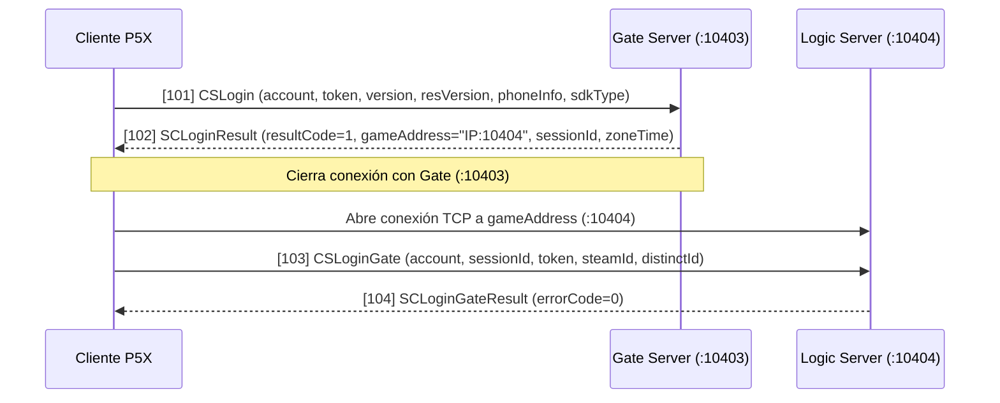
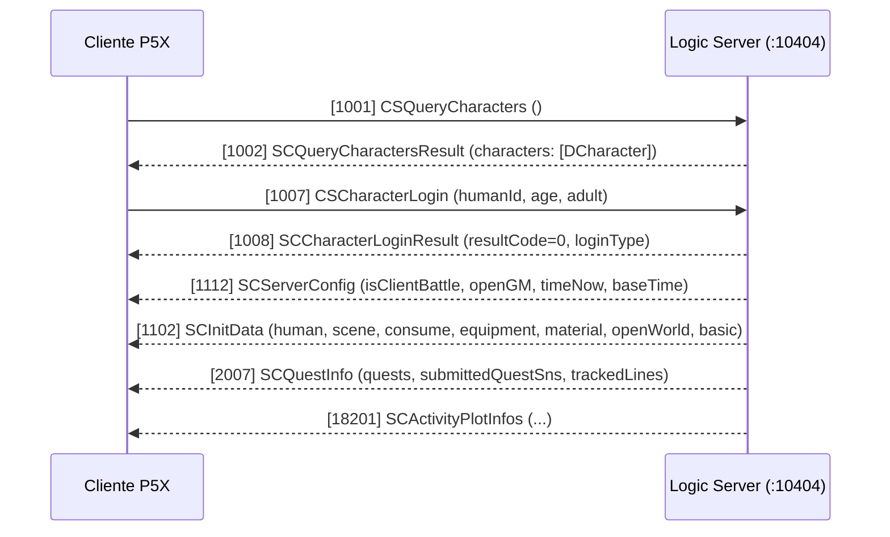
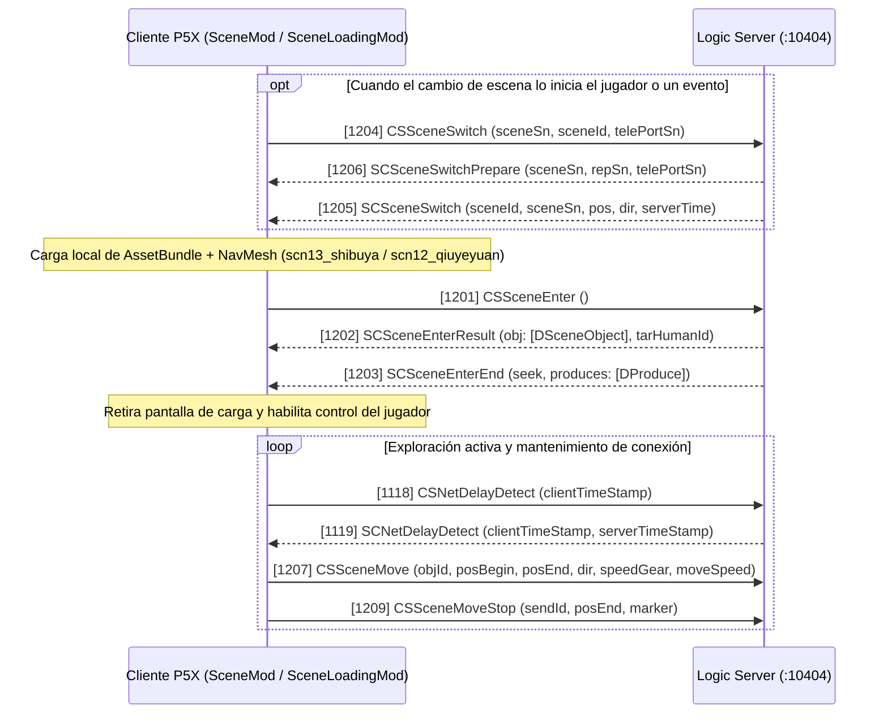
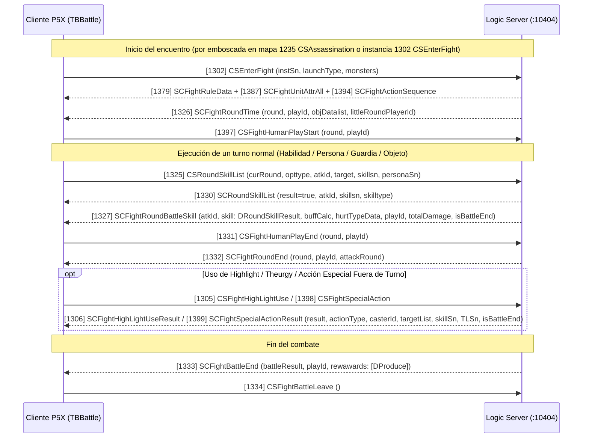

# Dependencias de Red y Flujos Críticos (`NETWORK_DEPENDENCIES.md`)

Este documento relaciona los mensajes extraídos de `allMsgPb.bytes` ([msg.proto](file:///D:/secret/docs/msg.proto)) con las trazas reales registradas por el cliente Global/Steam en `Player.log` y `log_2026_11_12.log`, identificando los paquetes exactos requeridos para las cuatro operaciones esenciales del juego.

---

## 1. Flujo 1: Autenticación e Inicio de Sesión (Gate + Logic)

El inicio de sesión se divide en dos conexiones TCP independientes: primero contra el **Gate Server** (`eulogin.p5xjpupd.com:10403`) y luego contra el **Logic Server** (`<IP>:10404`).

### Mensajes obligatorios para iniciar sesión

| `MsgID` | Mensaje | Campos `required` (Obligatorios por Proto2) | Campos `optional` Clave para el Cliente | Rol en la Emulación |
|---|---|---|---|---|
| **`101`** | `CSLogin` | `account` (`string`, #1) | `password` (#2), `token` (#3), `channelId` (#4), `mediaId` (#5), `version` (#6), `resVersion` (#7), `phoneInfo` (`DPhone`, #8), `sdkType` (#9), `serverUUID` (#10), `channelPlatform` (#11) | Primer paquete enviado al puerto `10403`. |
| **`102`** | `SCLoginResult` | *(Ninguno marcado `required`, pero el cliente valida su contenido)* | `resultCode` (`int32`, #1 — en logs: `1` = éxito), `account` (#2), `zoneTime` (#3), `serverId` (#4), **`gameAddress`** (`string`, #5 — ej. `"3.220.171.158:10404"`), **`sessionId`** (`int64`, #6), `timeout` (#7), `revision` (#11) | Redirige al cliente hacia la IP y puerto del servidor lógico (`127.0.0.1:10404` en un servidor local). |
| **`103`** | `CSLoginGate` | `account` (`string`, #1), `sessionId` (`int64`, #2) | `token` (#3), `phoneInfo` (`DPhone`, #4), `sdkType` (#5), `serverUUID` (#6), `channelPlatform` (#7), `steamId` (#9), `distinctId` (#10) | Presenta ante el servidor lógico el `sessionId` emitido en `102`. |
| **`104`** | `SCLoginGateResult` | **`errorCode`** (`int32`, #1 — en logs: `0` = éxito) | — | Autoriza la sesión en el servidor lógico. |

---

## 2. Flujo 2: Carga de Personaje e Inicialización de Partida

Una vez autenticado en el servidor lógico (`SCLoginGateResult.errorCode == 0`), el cliente consulta la lista de personajes, inicia sesión con el `humanId` (`roleId`) y recibe el volcado de estado inicial.

### Mensajes obligatorios para cargar el personaje

| `MsgID` | Mensaje | Campos `required` | Campos Clave y Dependencias |
|---|---|---|---|
| **`1001`** | `CSQueryCharacters` | *(Vacío)* | Solicita los personajes asociados a la cuenta. Si no existe ninguno, el cliente usa `1003 CSCharacterCreate` (`required string name = 1`). |
| **`1002`** | `SCQueryCharactersResult` | — | `repeated DCharacter characters = 1`. En `DCharacter`, **`id` (`int64`, #1) es `required`**, acompañado de `name` (#2), `level` (#4), `model` (#6) y `sn` (#11). |
| **`1007`** | `CSCharacterLogin` | **`humanId`** (`int64`, #1) | Envía el `DCharacter.id` seleccionado (`roleId` en logs) más `age` (#2) y `adult` (#3). |
| **`1008`** | `SCCharacterLoginResult` | **`resultCode`** (`int32`, #1 — `0` = éxito) | `optional ELoginType loginType = 2` (`LOGIN_DEFAULT = 0`). |
| **`1112`** | `SCServerConfig` | **`isClientBattle`** (`bool`, #1), **`openGM`** (`bool`, #2), **`timeNow`** (`int64`, #3), **`baseTime`** (`int64`, #4) | **Hallazgo clave para preservación:** Incluye los flags booleanos `isClientBattle` (batalla calculada en cliente) y `openGM` (habilitación de consola/comandos GM en cliente). |
| **`1102`** | `SCInitData` | *(Subcampos en `DInitScene`)* | Contiene el estado maestro del jugador: - `human` (`DHuman`, #1): nivel, HP/SP, `modelSn`, monedas (`DNewCurrency`), mapas urbanos desbloqueados (`unlockedUrbanMaps`). - **`scene` (`DInitScene`, #2):** tiene 3 campos **`required`**: `posNow` (`DVector3`, #1), `id` (`int64`, #2) y `sn` (`int32`, #3 — ej. `2102` para Shibuya). - Contenedores de inventario (`DItemContainer`, #3..#7, #10, #11), `openWorld` (`DOpenWorld`, #8) y `basic` (`DBasic`, #9). |
| **`2007`** | `SCQuestInfo` | — | `repeated DQuest quests = 1`. Sincroniza las misiones activas al entrar al mundo. |

---

## 3. Flujo 3: Entrada, Exploración y Transición de Escenas

Tanto en el arranque (cuando `SCInitData` indica `DInitScene.sn = 2102`) como al cruzar un portal o cambiar de distrito (ej. Shibuya `2102` $\rightarrow$ Akihabara `400` $\rightarrow$ Arcade `401`), `SceneLoadingMod` ejecuta una barrera de sincronización estricta:

### Mensajes obligatorios para entrar y explorar una escena

| `MsgID` | Mensaje | Campos `required` | Función Crítica en el Cliente |
|---|---|---|---|
| **`1206`** | `SCSceneSwitchPrepare` | **`sceneSn`** (`int32`, #1) | Prepara al cliente para descargar la escena actual y abrir la pantalla de carga hacia `sceneSn`. |
| **`1205`** | `SCSceneSwitch` | — | Define las coordenadas exactas (`pos` `DVector3` #4, `dir` `DVector2` #12), `sceneSn` (#2) y parámetros de instancia. |
| **`1201`** | `CSSceneEnter` | *(Vacío)* | Enviado por el cliente cuando `bBundleFinish:True` y `bNavFinish:True` (el mapa 3D ya está cargado en RAM). |
| **`1202`** | `SCSceneEnterResult` | — | Devuelve `repeated DSceneObject obj = 1` (entidades dinámicas presentes en el mapa: el propio jugador, monstruos, NPCs, cofres) y libera el evento de carga de protagonista (`等待事件2`). |
| **`1203`** | `SCSceneEnterEnd` | — | Finaliza la sincronización de entrada a escena y ordena a `SceneLoadingMod` cerrar la cortinilla de transición. |
| **`1118` / `1119`** | `CSNetDelayDetect` / `SCNetDelayDetect` | — | Latido periódico (*heartbeat*) observado constantemente en los logs (`CSNetDelayDetect` $\rightarrow$ `SCNetDelayDetect`). Sin respuesta, `NetMod` desconecta la sesión por *timeout*. |
| **`1240`..`1244`** | `SCSceneEnterOnlyClient` / `CSSceneEnterOnlyClient` | **`sceneSn`** (`int32`, #1) | Modo de transición rápida para subescenas puramente locales donde el servidor solo registra el cambio de `sceneSn` y devuelve la posición al salir (`SCSceneLeaveOnlyClient`). |

---

## 4. Flujo 4: Inicio y Ejecución de un Turno de Combate (`TBBattle`)

Los registros de combate en `log_2026_11_12.log` junto con el rango `1301..1399` de `msg.proto` revelan la arquitectura exacta del sistema de batalla por turnos:

### Mensajes clave para ejecutar un turno de combate

| `MsgID` | Mensaje | Campos Clave | Responsabilidad en el Turno |
|---|---|---|---|
| **`1302`** | `CSEnterFight` | **`required int32 instSn = 1`**, `optional int32 launchType = 2`, `repeated int32 monsters = 3` | Solicita iniciar un combate contra un grupo de enemigos. |
| **`1326`** | `SCFightRoundTime` | **`required int64 playId = 17`**, `round` (#2), `littleRoundPlayerId` (#9), `repeated DBattleUnitObjectData objDatalist = 8` | Abre la ventana de decisión del turno actual, entregando el `playId` (identificador de sincronización de animación/turno) y el estado de HP/SP/balas/buffs de cada unidad (`DBattleUnitObjectData`). |
| **`1325`** | `CSRoundSkillList` | `curRound` (#1), `opttype` (#2), `atkId` (#3), `target` (#4), `skillsn` (#5), `personaSn` (#6), `qteScore` (#7), `isSpecialOpt` (#8) | **Paquete central de acción del jugador** (observado en `log_2026_11_12.log` como `TBBattleLog:CSRoundSkillList <skillsn> <target>`). |
| **`1327`** | `SCFightRoundBattleSkill` | **`required int64 playId = 24`**, `atkId` (#2), **`skill` (`DRoundSkillResult`, #3)**, `buff` (#4), `buffCalc` (#7), `hurtTypeData` (#15), `totalDamage` (#29), `isBattleEnd` (#17) | **Respuesta de resolución de turno (`OnTimeLineMessage` en logs):** contiene la lista de impactos (`DRoundSkillFunc`), daños, curaciones, alteraciones de estado y si el golpe derrotó al último enemigo (`isBattleEnd`). |
| **`1398` / `1399`** | `CSFightSpecialAction` / `SCFightSpecialActionResult` | `result` (`bool`, #1), `actionType` (#2), `casterId` (#3), `atkList` (#4), `targetList` (#5), `skillSn` (#6), `TLSn` (`string`, #7), `isBattleEnd` (#8) | Resuelve acciones especiales (ej. *All-Out Attack*, *1 More*, *Highlight* tras `1305`/`1306`, asistencias). En los logs se observa exactamente como `TBBattleLog:MsgID SCFightSpecialActionResult true 2`. |
| **`1331` / `1389`** | `CSFightHumanPlayEnd` / `CSFightTruePlayEnd` | `round` (#1), `playId` (#2) | Notifica al servidor que el cliente terminó de reproducir la cinemática/animación del turno para que el servidor avance al siguiente actor en la barra de acción (`1394 SCFightActionSequence`). |
| **`1333`** | `SCFightBattleEnd` | `battleResult` (#1), `playId` (#2), `repeated DProduce rewawards = 4` | Cierra el combate y entrega la lista de objetos/experiencia obtenidos. |

---

## 5. Implicación Arquitectónica de `SCServerConfig.isClientBattle` (`MsgID 1112`)

El descubrimiento del campo **`required bool isClientBattle = 1`** dentro de `SCServerConfig` (`MsgID 1112`) abre una línea de investigación de altísimo valor para la preservación:
- Si el código Lua/C# del cliente conserva funcional el modo `isClientBattle = true` (utilizado habitualmente por los desarrolladores para pruebas offline o etapas tempranas), activarlo en `SCServerConfig` podría hacer que el propio cliente resuelva localmente los cálculos de combate usando `ConfDataBattle.bytes`, reduciendo drásticamente la cantidad de lógica matemática que el servidor local necesitaría reimplementar.
- Esto deberá verificarse inspeccionando las referencias a `isClientBattle` dentro de los scripts Lua locales en el siguiente experimento.
