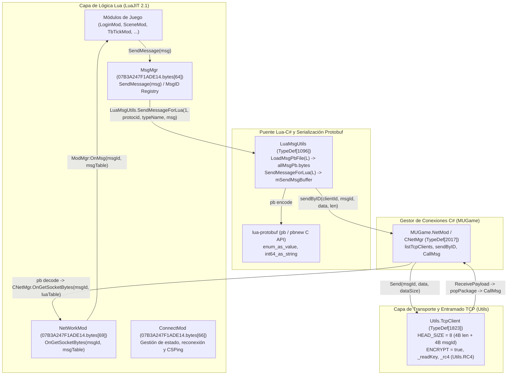

# Análisis Estático del Protocolo de Transporte y Entramado de Red (Prioridad 2)

**Objetivo:** Documentar la arquitectura de transporte de red de *Persona 5: The Phantom X (P5X)* desde la capa de módulos Lua (`MsgMgr`, `NetWorkMod`, `ConnectMod`) hasta la capa de sockets C# (`LuaMsgUtils`, `MUGame.NetMod`, `Utils.TcpClient`, `Utils.RC4`), distinguiendo rigurosamente entre los formatos y constantes confirmados estáticamente y los aspectos de cable (*wire-level*) que requieren captura pasiva.

---

## 1. Arquitectura de Capas de Red (Lua ↔ C# IL2CPP)

El análisis cruzado de los paquetes Lua (`.bytes`) y de `global-metadata.dat` demuestra que la pila de red de P5X se divide en cuatro capas bien definidas:



---

## 2. Análisis de la Capa Lua y el Puente `LuaMsgUtils`

### 2.1. Inicialización del Esquema Protobuf (`1410A9F67109B47.bytes[452]`, `Proto[8]`)
El cliente utiliza la bandera global `_G.isUseNewProto = true` (confirmada tanto en bytecode como en `Player.log` mediante la traza `begin Lpb_loadfile_from_bytes 223978`).

En `1410A9F67109B47.bytes[452] Proto[8]` (`21` instrucciones):
```lua
if _G.isUseNewProto and pbnew then
    pbnew.option("enum_as_value")
    pbnew.option("int64_as_string")
    LuaMsgUtils.LoadMsgPbFile()
end
```
- **Implicación crítica para el servidor:**
  1. `enum_as_value`: En Lua, los campos de tipo `enum` se leen y escriben como sus valores enteros numéricos (no como strings).
  2. `int64_as_string`: En LuaJIT, los enteros de 64 bits (`int64` / `uint64` en Protobuf, como `roleId`, `uuid`, `baseTime`, `timeNow`) se representan en tablas Lua como cadenas decimales (o prefijadas según `lua-protobuf`), pero **en el cable se codifican como `varint` estándar de Protobuf**.

---

### 2.2. Ruta de Envío (`MsgMgr:SendMessage` — `07B3A247F1ADE14.bytes[64]`, `Proto[4]`)
El desensamblado de `07B3A247F1ADE14.bytes[64] Proto[4]` (`46` instrucciones) muestra las dos rutas (la ruta activa `_G.isUseNewProto` y la ruta heredada):

```lua
function SendMessage(msg)
    if _G.isUseNewProto then
        local msgTypeName = msg._msg_Type_Name
        msg._msg_Type_Name = nil
        -- Invoca C# LuaMsgUtils.SendMessageForLua(clientId=1, msg.protocid, msgTypeName, msg)
        LuaMsgUtils.SendMessageForLua(1, msg.protocid, msgTypeName, msg)
        if GMCmdMgr and GMCmdMgr.showClientMsgCS then
            print("--Send Message--", msgTypeName, getTableStr(msg))
        end
        if ConnectMgr then
            ConnectMgr:OnRecordSend(msg.protocid)
        end
    else
        -- Ruta heredada (inactiva)
        CNetMgr:SendMessage(msg.protocid, msg:SerializeToString())
    end
end
```
- Cuando un módulo Lua construye un mensaje (p. ej., `local msg = MsgMgr.CSLogin()`), `MsgMgr` crea una tabla Lua con dos metadatos temporales:
  - `msg.protocid`: el identificador numérico `MsgID` (p. ej., `1001` para `CSLogin`).
  - `msg._msg_Type_Name`: el nombre del tipo Protobuf (p. ej., `"CSLogin"`).
- Antes de serializar, `SendMessage` extrae `_msg_Type_Name` y lo pone a `nil` para que no interfiera con el codificador C, y llama a `LuaMsgUtils.SendMessageForLua(1, msg.protocid, msgTypeName, msg)`.

---

### 2.3. Ruta de Recepción (`NetWorkMod:OnGetSocketBytes` — `07B3A247F1ADE14.bytes[69]`, `Proto[4]`)
En `NetWorkMod:Init` (`07B3A247F1ADE14.bytes[69] Proto[1]`), Lua registra dos callbacks en el singleton C# `CNetMgr` (`MUGame.NetMod.Instance`):
- `CNetMgr.OnGetSocketBytes = function(msgId, data) NetWorkMod.Instance():OnGetSocketBytes(msgId, data) end`
- `CNetMgr.OnNetWorkFun = function(clientId, socketId, state, err) ... end`

El desensamblado de `NetWorkMod:OnGetSocketBytes` (`Proto[4]`, `74` instrucciones) revela un detalle arquitectónico clave en las instrucciones `[000]..[006]`:
```lua
function NetWorkMod:OnGetSocketBytes(msgId, data)
    local msg = nil
    if _G.isUseNewProto then
        -- Con isUseNewProto = true, C# (MUGame.NetMod.CallMsg) YA decodificó el binario
        -- Protobuf a una tabla Lua usando lua-protobuf antes de invocar OnGetSocketBytes.
        msg = data
    else
        if MsgTable[msgId] == nil then return end
        msg = _G.protocol[MsgMgr[msgId]]()
        msg:ParseFromString(data)
    end
    if msgId < 1 or msgId <= 0 then
        logerr("OnGetSocketBytes msg is error, text sn=1046007, DisConnect, msg id =", msgId)
        ConnectMgr:DisConnect()
        ConnectMgr:OnConfirmReturnLogin(GetStr(1046007))
        return
    end
    if ConnectMgr then
        ConnectMgr:OnRecordReceive(msgId)
    end
    ModMgr:OnMsg(msgId, msg)
    if GMCmdMgr and GMCmdMgr.showClientMsgSC then
        print("--Get Message--", MsgTable[msgId], getTableStr(msg))
    end
end
```

---

## 3. Análisis de las Clases C# de Transporte en `global-metadata.dat`

La inspección de la tabla `Il2CppTypeDefinition` (`18,315` tipos) y `Il2CppMethodDefinition` (`140,823` métodos) en `global-metadata.dat` permitió identificar todas las clases C# involucradas en el transporte:

### 3.1. `LuaMsgUtils` (`TypeDef[1096]`, namespace global)
- **Campos:**
  - `mAllMsgPbBytes` (`byte[]`): Buffer estático donde se carga `allMsgPb.bytes`.
  - `mSendMsgBuffer` (`byte[]`): Buffer reutilizable para serializar mensajes salientes desde Lua.
- **Métodos:**
  - `Register(LuaState L)`
  - `GetSendMsgBuffer(int len) -> byte[]`
  - `SendMessageForLua(IntPtr L) -> int`
  - `LoadMsgPbFile(IntPtr L) -> int`

### 3.2. `MUGame.NetMod` (`TypeDef[2017]`, expuesto a Lua como `CNetMgr`)
- **Campos:**
  - `listTcpClients` (`List<Utils.TcpClient>`): Lista de clientes TCP activos (el cliente principal usa `clientId = 1`).
  - `instance` (`MUGame.NetMod`)
  - `OnGetSocketBytes` (`LuaFunction`)
  - `OnNetWorkFun` (`LuaFunction`)
- **Métodos principales:**
  - `CreateClient(int id)`
  - `GetTcpClient(int clientId) -> Utils.TcpClient`
  - `Connect(int clientId, int socket_id, string ip, int port, int millisecondtimeout) -> int`
  - `Disconnect(int clientId, bool isManul)`
  - `sendByID(int clientId, int msgId, byte[] data, int len)`
  - `CallMsg(uint msgid, byte[] data)`
  - `onlua_OnNormalNetWorkState(int clientId, int socketId, int eState, int errorCode)`

### 3.3. `Utils.TcpClient` (`TypeDef[1823]`) y Constantes por Defecto Confirmadas
La clase `Utils.TcpClient` (`TypeDef[1823]`, `27` campos y `34` métodos) implementa el entramado TCP sobre `Utils.NetTcpClient` (`TypeDef[1822]`).

Al decodificar la tabla `fieldDefaultValues` (`offset 0xA03818` / `fieldAndParameterDefaultValueData`) de `global-metadata.dat` usando la codificación de enteros comprimidos de IL2CPP v31, se obtuvieron los **valores constantes exactos compilados en `Utils.TcpClient`**:

| Índice de Campo | Nombre del Campo en `Utils.TcpClient` | Offset `d_idx` | Bytes Crudos (IL2CPP v31) | Valor Decodificado Exacto | Significado Técnico Confirmado |
| ---: | :--- | ---: | :--- | :--- | :--- |
| `5801` | `MAX_BUFF_SIZE` | `3266` | `C0 08 00 00` | **`262,144`** (`256 KB`) | Tamaño máximo del buffer de recepción/envío por paquete |
| `5802` | `HEAD_SIZE` | `3270` | `10` (`0x10 >> 1`) | **`8` bytes** | Tamaño fijo de la cabecera TCP de cada mensaje |
| `5816` | `ENCRYPT` | `3271` | `01` (`bool`) | **`true`** | Bandera estática/constante de cifrado habilitada |
| `5819` | `netdata_definelen_usebytes` | `3272` | `08` (`0x08 >> 1`) | **`4` bytes** | Tamaño del campo de longitud dentro de la cabecera (`int32`) |
| `5820` | `msgdata_type_usebytes` | `3273` | `08` (`0x08 >> 1`) | **`4` bytes** | Tamaño del campo `msgId` dentro de la cabecera (`int32`) |

Además, `Utils.TcpClient` contiene los siguientes campos de estado y métodos de lectura/escritura de tramas:
- **Campos de entramado y cifrado:**
  - `_sendHeaderBuffer` (`byte[]`)
  - `lastMsgLength` (`int`)
  - `binaryReader` (`System.IO.BinaryReader`)
  - `_receivePackage` (`Utils.ThreadSafeQueue<Utils.SMsgData>`)
  - `ENCRYPT` (`bool = true`)
  - `_readKey` (`bool`)
  - `_rc4` (`Utils.RC4`)
- **Métodos de entramado:**
  - `readInt32FromNetwork(BinaryReader br) -> int`
  - `ReceivePayload(byte[] data, int length)`
  - `pushPackage(SMsgData msg)` / `popPackage() -> SMsgData`
  - `Send(int msgId, byte[] data, int dataSize)`
  - `Send_begin(int msgId, byte[] data, int dataSize)`
  - `rawSend(byte[] buf, int start, int end)`
  - `setBufferInt(byte[] buf, int value, int offset)`
  - `getBufferInt(byte[] buf) -> int`

### 3.4. `Utils.RC4` (`TypeDef[1830]`)
- **Campos:**
  - `S` (`byte[]`): Permutación de estado de 256 bytes del cifrador de flujo RC4.
  - `_i` (`int`), `_j` (`int`): Índices de estado RC4.
- **Métodos:**
  - `.ctor(byte[] key)`: Inicialización KSA (*Key-Scheduling Algorithm*) con clave `byte[]`.
  - `Crypt(byte[] pt, int start, int end)`: Cifrado/descifrado PRGA in-place sobre el rango `[start, end)`.

---

## 4. Estructura de Cabecera TCP Confirmada vs. Incógnitas de Cable

### 4.1. Lo que está Confirmado Estáticamente
1. **Tamaño de cabecera:** Exactamente **8 bytes** (`HEAD_SIZE = 8`), formados por:
   - **4 bytes** para la longitud (`netdata_definelen_usebytes = 4`).
   - **4 bytes** para el identificador del mensaje `MsgID` (`msgdata_type_usebytes = 4`).
2. **Endianness de los enteros de cabecera:** La presencia de `readInt32FromNetwork(BinaryReader br)` y `setBufferInt(byte[] buf, int value, int offset)` / `getBufferInt(byte[] buf)` indica conversión explícita entre el orden de bytes de red (**Big-Endian**, `network byte order`) y el orden nativo x86_64 (`Little-Endian`).
3. **Payload:** Cuerpo binario serializado en **Protobuf wire format** correspondiente al mensaje cuyo `MsgID` figura en la cabecera (`allMsgPb.bytes`). No se observan clases de compresión (como `LZ4` o `Zstd`) acopladas a `Utils.TcpClient`.
4. **Existencia de capa RC4 (`Utils.RC4`):** `Utils.TcpClient` tiene `ENCRYPT = true`, un booleano `_readKey` y un objeto `_rc4`.

### 4.2. Hipótesis e Incógnitas que Requieren Verificación (Captura Pasiva o Inspección de Métodos C#)
Dado que `global-metadata.dat` contiene las firmas, nombres y constantes de `Utils.TcpClient`, pero el cuerpo de las instrucciones máquina de `Send_begin`, `ReceivePayload` y `DealMessage` reside en `GameAssembly.dll`, quedan **tres detalles puntuales por confirmar**:

1. **Orden de los dos campos en los 8 bytes de cabecera:**
   - *Hipótesis principal (estándar en motores `MUGame` de Perfect World):*
     ```text
     +------------------------+------------------------+-------------------------------+
     | Offset 0..3 (4 bytes)  | Offset 4..7 (4 bytes)  | Offset 8..8+N-1 (N bytes)     |
     | Packet/Payload Length  | MsgID (int32 / uint32) | Protobuf Serialized Payload   |
     | (Big-Endian int32)     | (Big-Endian int32)     | (byte[N])                     |
     +------------------------+------------------------+-------------------------------+
     ```
   - *Variante a verificar:* Si el campo `Length` en los primeros 4 bytes representa `N` (solo la longitud del payload Protobuf), `N + 4` (payload + `MsgID`), o `N + 8` (trama total incluyendo cabecera).
2. **Negociación de `_readKey` y uso de `_rc4` (`Utils.RC4`):**
   - La existencia del campo `bool _readKey` junto a `Utils.RC4 _rc4` en `Utils.TcpClient` sugiere fuertemente que, al establecerse la conexión TCP con el servidor (`10403`/`10404`), el primer bloque de datos enviado por el servidor contiene la clave de sesión RC4 (cuando `_readKey == false`, el cliente lee la clave, instancia `_rc4 = new RC4(key)` y marca `_readKey = true`).
   - Debe confirmarse qué longitud tiene esa clave inicial enviada por el servidor y si `_rc4.Crypt(...)` se aplica a los paquetes salientes (`Send_begin`), a los entrantes (`ReceivePayload`), o únicamente en una dirección, y si cifra también la cabecera o solo el payload.
3. **Canal de prueba HTTP local vestigial (`E0FE49AEBE4F265D4.bytes[17]`):**
   - Se identificó un módulo de prueba en `E0FE49AEBE4F265D4.bytes[17]` que invoca `LuaMsgUtils.HttpGet` y `LuaMsgUtils.HttpPost` contra `http://127.0.0.1:3000` (enviando `CSPing` y `SC_DC_EnterBattle`). Sin embargo, `LuaMsgUtils` en `global-metadata.dat` (`TypeDef[1096]`) ya no exporta `HttpGet` ni `HttpPost` (solo `Register`, `GetSendMsgBuffer`, `SendMessageForLua`, `LoadMsgPbFile`), lo que confirma que ese script Lua es un remanente de pruebas internas y que todo el tráfico real usa `Utils.TcpClient`.
