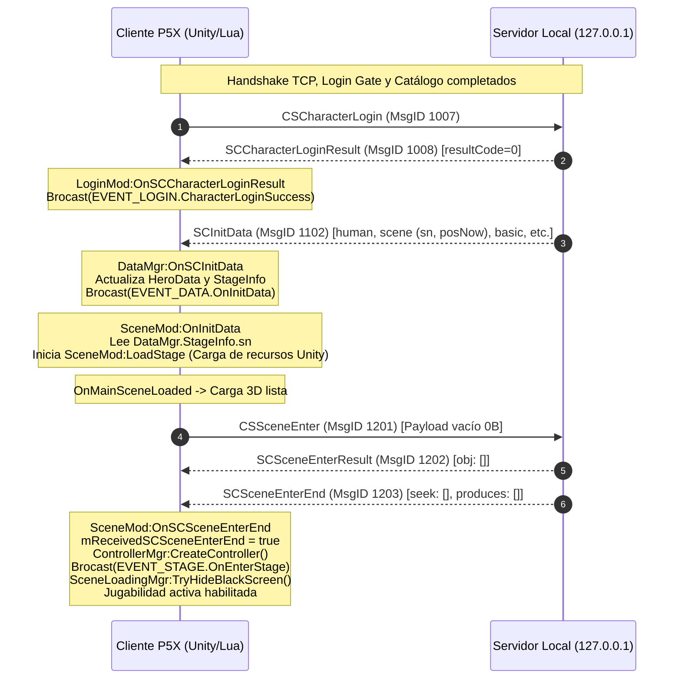

# Mapa de Mensajes y Secuencia: Desde Login hasta Carga de Escena

**Proyecto:** Preservación y emulación de servidores de *Persona 5: The Phantom X (P5X)*  
**Cliente objetivo:** Versión PC Global/Steam (`client\pc\GameAssembly.dll`, `client\OuterPackage\Lua\Windows\`)  
**Metodología:** Análisis estático de solo lectura sobre bytecode LuaJIT 2.1 y descriptores Protobuf oficiales (`allMsgPb.bytes`).

---

## 1. Resumen Ejecutivo y Secuencia de Cable

El análisis del bytecode Lua de los controladores de red (`LoginMod`, `DataMgr`, `SceneMod` y `ConnectMod`) demuestra que el paso desde la confirmación de selección de personaje hasta la entrada en una escena 3D interactiva requiere una secuencia mínima de **5 mensajes de red**:



---

## 2. Flujo de Control Detallado en el Cliente Lua

### 2.1. Paso 1: Recepción de `SCCharacterLoginResult` (`MsgID 1008`)
- **Controlador:** `LoginMod:OnSCCharacterLoginResult(msg)` (`E8DF29521A39C99.bytes`, Chunk `0`, Proto `42`, VA strings `13781..14052`).
- **Evaluación lógica:**
  ```lua
  if msg.resultCode <= 0 then
      EventMgr:Brocast(EVENT_LOGIN.CharacterLoginSuccess)
      OneSDKMgr:TrackSDKRoleEvent(...)
  else
      ConnectMgr:DisConnect()
      SystemDialogTipMgr:ShowTip(...)
      self:OnConfirmReturnLogin()
  end
  ```
- **Conclusión crítica [CONFIRMADO]:** Si `resultCode == 0`, el cliente no solicita datos adicionales de inmediato; queda en espera pasiva de la carga inicial de datos (`SCInitData`).

### 2.2. Paso 2: Recepción y Desempaquetado de `SCInitData` (`MsgID 1102`)
- **Controlador:** `DataMgr:OnSCInitData(msg)` (`07B3A247F1ADE14.bytes`, Chunk `81`, Proto `51`, VA strings `6988..7750`).
- **Aclaración sobre `CSInitData` [CONFIRMADO]:** El mensaje `CSInitData` (`MsgID 1101`) **NO es enviado por el cliente durante el arranque inicial**. Se encuentra únicamente referenciado en `ConnectMod:OnRecoverNetwork` (`07B3A247F1ADE14.bytes`, Chunk `66`, offset `8817`) como mecanismo de sincronización tras una reconexión en caliente. En el login normal, el servidor debe inyectar `SCInitData` directamente tras `SCCharacterLoginResult`.
- **Efectos en los gestores internos:**
  1. `msg.human` (`DHuman`) $\rightarrow$ Almacenado en `DataMgr.HeroData` (nivel, nombre, HP/SP, monedas, atributos).
  2. `msg.scene` (`DInitScene`) $\rightarrow$ Almacenado en `DataMgr.StageInfo`:
     - `StageInfo.sn = msg.scene.sn` (Identificador del mapa/escena según `ConfScene`).
     - `StageInfo.posNow = msg.scene.posNow` (Coordenadas de reaparición inicial).
     - `StageInfo.dirNow = msg.scene.dirNow` (Orientación inicial del avatar).
  3. `msg.basic` (`DBasic`) $\rightarrow$ `SaferoomTeamShowMgr` y desbloqueo de mapas urbanos (`MapMgr:AddUnlockWorldMapList`).
  4. `msg.consume`, `equipment`, `material`, `sundry`, `suitCard` $\rightarrow$ `ItemMgr:InitGetItemBagInfo`.
  5. `msg.openWorld` $\rightarrow$ `NewOpenWorldTimeMgr:LogingInit`.
- **Disparo de evento:** Finaliza invocando `EventMgr:Brocast(EVENT_DATA.OnInitData)`.

### 2.3. Paso 3: Carga Asíncrona de Escena en `SceneMod:OnInitData`
- **Controlador:** `SceneMod:OnInitData()` (`07B3A247F1ADE14.bytes`, Chunk `83`, offset `18579..19702`, registrado en Chunk `141`).
- **Flujo de ejecución:**
  1. Consulta `DataMgr.StageInfo.sn` y valida su existencia en la tabla de configuración `ConfScene`.
  2. Valida la presencia de activos empaquetados mediante `BGDownloadMgr:CheckResTagDownloaded(resTag)`.
  3. Lanza la carga del nivel 3D en Unity: `SceneMod:LoadStage(DataMgr.StageInfo)`.
  4. La pantalla de carga (`UI_LoadingView` / `SceneLoadingMgr`) permanece visible bloqueando el control del usuario.

### 2.4. Paso 4: Notificación de Escena Cargada (`CSSceneEnter`, `MsgID 1201`)
- **Disparador:** Callback `SceneMod:OnMainSceneLoaded()`.
- **Acción:** El cliente envía al servidor la señal de que los modelos, colliders y mallas de navegación están instanciados en memoria:
  `MsgMgr:SendMessage(CSSceneEnter)`.
- **Cuerpo:** Mensaje Protobuf vacío (longitud de payload: `0` bytes; tamaño en cable: `8` bytes de cabecera `[len=8][msgId=1201]`).

### 2.5. Paso 5: Respuestas `SCSceneEnterResult` (1202) y `SCSceneEnterEnd` (1203)
- **Controladores:** 
  - `SceneMod:OnSCSceneEnterResult(msg)` (`07B3A247F1ADE14.bytes`, Chunk `83`, offset `20959`).
  - `SceneMod:OnSCSceneEnterEnd(msg)` (`07B3A247F1ADE14.bytes`, Chunk `83`, offset `20890`).
- **Acciones ejecutadas:**
  1. `SCSceneEnterResult`: Desempaqueta `msg.obj` (`repeated DSceneObject`). Si la lista contiene entidades/NPCs, los instancia en el mundo. Para un arranque preservado mínimo, puede ser una lista vacía `[]`.
  2. `SCSceneEnterEnd`: Establece `SceneMod.mReceivedSCSceneEnterEnd = true`.
  3. Instancia el controlador local del avatar principal: `ControllerMgr:CreateController()`.
  4. Aplica rotación y posición según `posNow` y `dirNow`.
  5. Activa post-procesado y efectos: `ShaderMod:Instance():SetKaleidoscope()`.
  6. Emite el evento global: `EventMgr:Brocast(EVENT_STAGE.OnEnterStage)`.
  7. Registra en log: `print("====SceneMod: OnEnterStage1 ====")`.
  8. Oculta el telón negro de carga: `SceneLoadingMgr:TryHideBlackScreen()`.
  9. Restablece la interactividad del usuario: `KeyBoardPressMgr:LockKeyBoard(false)` y `OpenWorldDataEvents:ForbideInteract(false)`.

---

## 3. Especificación Formal de Mensajes Protobuf

### 3.1. `SCCharacterLoginResult` (`MsgID 1008`)
- **Dirección:** Servidor $\rightarrow$ Cliente
- **Definición en `allMsgPb.bytes`:**
  ```protobuf
  message SCCharacterLoginResult {
    required int32 resultCode = 1;
    optional ELoginType loginType = 2;
  }
  ```
- **Valores requeridos para preservación:**
  - `resultCode`: `0` (Éxito absoluto).
  - `loginType`: `1` (`NORMAL`).
- **Tamaño aproximado en cable:** `12` bytes (`8` bytes cabecera + `4` bytes payload Protobuf).

---

### 3.2. `SCInitData` (`MsgID 1102`)
- **Dirección:** Servidor $\rightarrow$ Cliente
- **Definición en `allMsgPb.bytes`:**
  ```protobuf
  message SCInitData {
    optional DHuman human = 1;
    optional DInitScene scene = 2;
    optional DItemContainer consume = 3;
    optional DItemContainer equipment = 4;
    optional DItemContainer material = 5;
    optional DItemContainer sundry = 6;
    optional DItemContainer suitCard = 7;
    optional DOpenWorld openWorld = 8;
    optional DBasic basic = 9;
    optional DItemContainer warChess = 10;
    optional DItemContainer trove = 11;
  }
  ```
- **Estructura mínima necesaria para inicialización:**

  #### A. `scene: DInitScene` (Obligatorio para que `SceneMod` arranque)
  ```protobuf
  message DInitScene {
    required DVector3 posNow = 1;      // Coordenadas x, y, z (float)
    required int64 id = 2;             // Identificador de instancia de escena (int64)
    required int32 sn = 3;             // Serial Number de la escena (int32)
    optional int32 instanceSn = 4;     // ID de instancia (0 o sn)
    optional int32 lineNum = 5;        // Número de línea/canal (1)
    repeated DRandomTile tiles = 6;    // Vacío en escenas estáticas
    optional DVector2 dirNow = 10;     // Dirección frontal x, y (float)
  }
  ```
  - *Campos obligatorios Proto2:* `posNow`, `id`, `sn`.
  - *Coordenadas de ejemplo:* `posNow = {x: 0.0, y: 0.0, z: 0.0}`, `id = 10001`, `sn = 10001` (o ID de escenario tutorial/inicio), `dirNow = {x: 0.0, y: 1.0}`.

  #### B. `human: DHuman` (Obligatorio para que `HeroData` inicialice el avatar)
  ```protobuf
  message DHuman {
    optional int64 id = 1;             // Identificador de personaje (coincidente con CSCharacterLogin)
    optional string name = 3;          // Nombre del protagonista (p. ej. "Wonder")
    optional int32 level = 4;          // Nivel (p. ej. 1)
    optional int32 sex = 5;            // Género (1 = Masculino)
    optional int32 hpCur = 6;          // Puntos de salud actuales (p. ej. 100)
    optional int32 spCur = 7;          // Puntos de energía actuales (p. ej. 100)
    optional int64 userId = 12;        // ID de cuenta de usuario
    repeated DNewCurrency currencies = 37; // Monedas iniciales
  }
  ```

  #### C. `basic: DBasic`
  ```protobuf
  message DBasic {
    optional bool bAuto = 1;           // false
    optional bool bEnterSafeRoom = 5;  // false
  }
  ```

  #### D. `openWorld: DOpenWorld`
  ```protobuf
  message DOpenWorld {
    optional int32 periodSn = 1;       // Período del día (1 = Mañana / Tarde)
    optional int32 daySn = 2;          // Día del calendario (1)
    optional int32 phaseType = 4;      // Fase (1)
  }
  ```

- **Tamaño aproximado en cable:** `80..350` bytes según campos poblados.

---

### 3.3. `CSSceneEnter` (`MsgID 1201`)
- **Dirección:** Cliente $\rightarrow$ Servidor
- **Definición en `allMsgPb.bytes`:**
  ```protobuf
  message CSSceneEnter {
    // Sin campos — señalización de carga completada
  }
  ```
- **Tamaño en cable:** `8` bytes (`0x00000008` longitud, `0x000004B1` MsgID 1201, 0 bytes de payload cifrado RC4).

---

### 3.4. `SCSceneEnterResult` (`MsgID 1202`)
- **Dirección:** Servidor $\rightarrow$ Cliente
- **Definición en `allMsgPb.bytes`:**
  ```protobuf
  message SCSceneEnterResult {
    repeated DSceneObject obj = 1;
    optional int64 tarHumanId = 2;
    optional int64 unionStationUnionId = 3;
  }
  ```
- **Valores para servidor mínimo:**
  - `obj`: `[]` (Sin NPCs ni monstruos adicionales inicialmente).
  - `tarHumanId`: `id` del jugador.
- **Tamaño aproximado en cable:** `10..20` bytes.

---

### 3.5. `SCSceneEnterEnd` (`MsgID 1203`)
- **Dirección:** Servidor $\rightarrow$ Cliente
- **Definición en `allMsgPb.bytes`:**
  ```protobuf
  message SCSceneEnterEnd {
    repeated int32 seek = 1;
    repeated DProduce produces = 2;
  }
  ```
- **Valores para servidor mínimo:**
  - `seek`: `[]`
  - `produces`: `[]`
- **Tamaño en cable:** `8` bytes (Cabecera de 8 bytes con payload Protobuf vacío de 0 bytes).

---

## 4. Descarte de Hipótesis y Mensajes Inexistentes

| Mensaje consultado | Estado en el cliente | Referencia / Cita |
| :--- | :--- | :--- |
| `CSLoginEnd` | **INEXISTENTE** | No existe en `allMsgPb.bytes` ni en `protocol/MsgId`. El ciclo de login termina con la recepción de `SCCharacterLoginResult` y la inyección de `SCInitData`. |
| `CSInitData` inicial | **DESESTIMADO** | Solo existe en `ConnectMod` para reconexión de red (`EVENT_LOGIN.ReconnectSuccess`). No se emite en el arranque en frío. |
| `CSQueryTimeInfo` | **OPCIONAL** | `NewOpenWorldTimeMod` lo solicita en segundo plano para el reloj urbano, pero su ausencia no bloquea la transición 3D. |
| `CSGetFriendList` | **OPCIONAL** | Emitido asíncronamente por `FriendMod` tras `CharacterLoginSuccess`; no afecta la escena. |

---

## 5. Tabla de Estado y Próximos Pasos de Emulación

| Etapa | Mensaje | Estado actual | Acción para Fase 3 (Servidor de Escena) |
| :--- | :--- | :--- | :--- |
| 1 | `SCCharacterLoginResult` (`1008`) | Implementado en `poc_login_server.py` | Validado. Retorna `resultCode=0`. |
| 2 | `SCInitData` (`1102`) | Diseñado en este mapa | Codificar función generadora en `proto2_codec.py` con `posNow`, `sn` y `human`. |
| 3 | `CSSceneEnter` (`1201`) | Diseñado en este mapa | Añadir receptor de trama en el despachador TCP. |
| 4 | `SCSceneEnterResult` (`1202`) | Diseñado en este mapa | Responder trama con lista vacía de entidades. |
| 5 | `SCSceneEnterEnd` (`1203`) | Diseñado en este mapa | Responder trama final para cerrar la pantalla de carga. |
